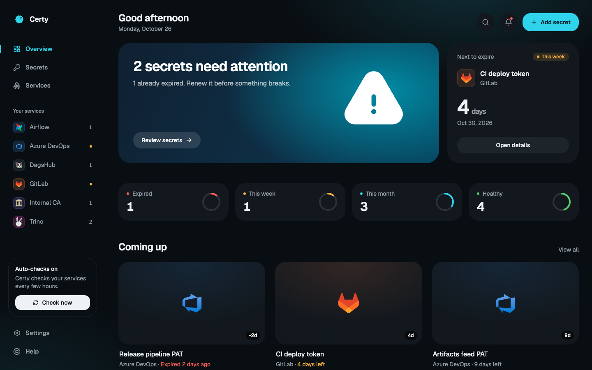
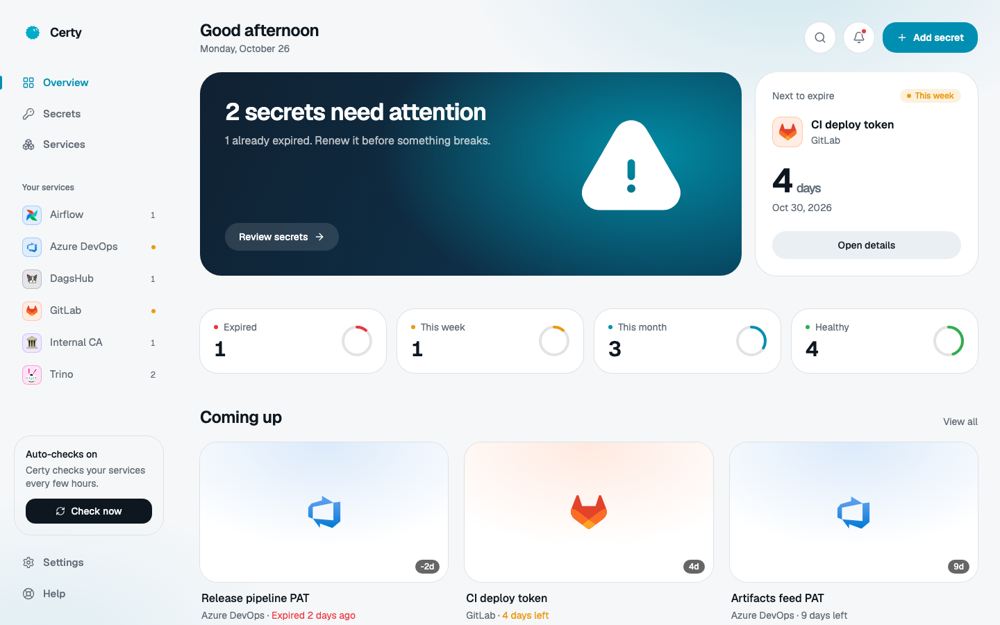
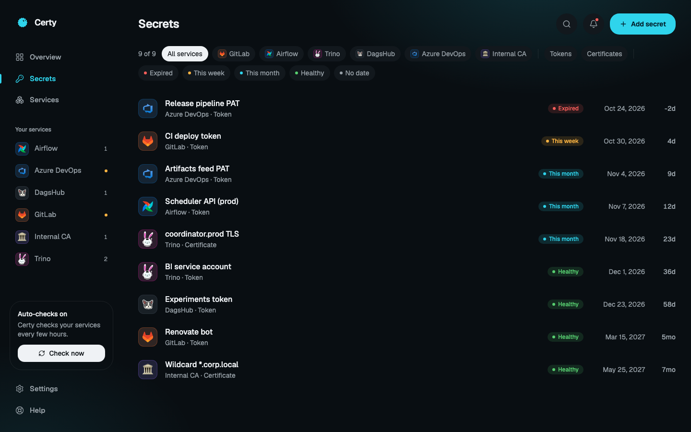
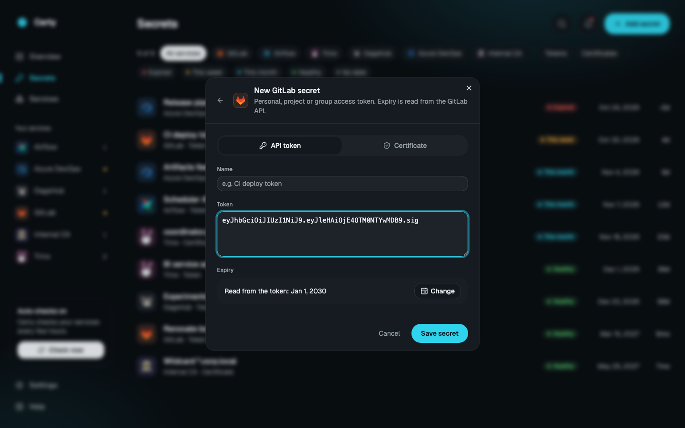
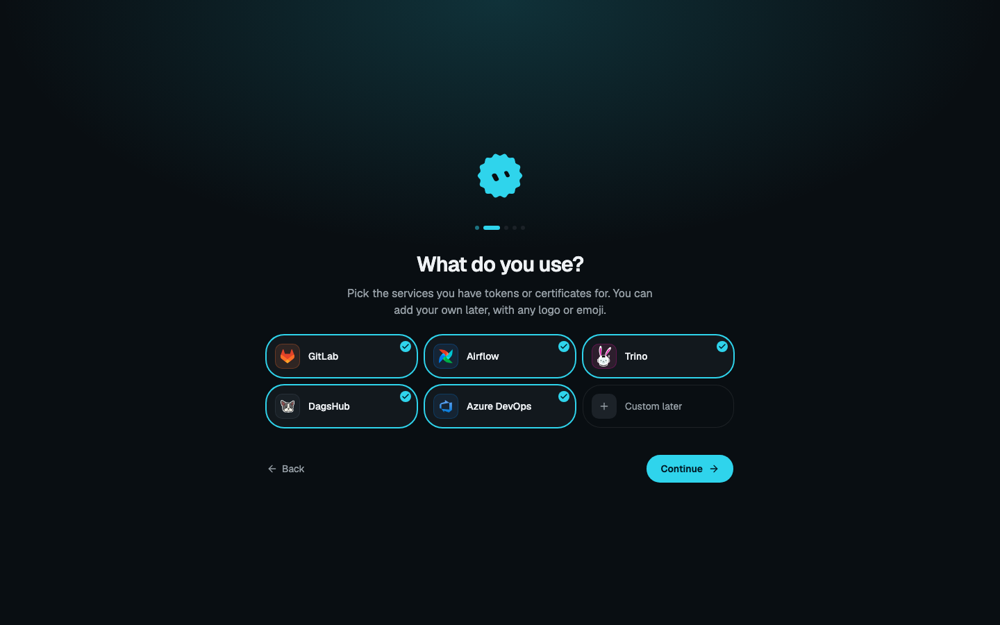

<a id="readme-top"></a>

<h1 align="center">
  
  <br />
  <b>Certy</b>
</h1>

<p align="center">
  A Windows desktop app that tracks when your API tokens and certificates expire and reminds you with a desktop notification — local-only and encrypted.
</p>

<p align="center">
  
  
  
  
  
</p>

<p align="center">
  <a href="#about">About</a> &nbsp;|&nbsp;
  <a href="#features">Features</a> &nbsp;|&nbsp;
  <a href="#screenshots">Screenshots</a> &nbsp;|&nbsp;
  <a href="#tech-stack">Tech Stack</a> &nbsp;|&nbsp;
  <a href="#getting-started">Getting Started</a> &nbsp;|&nbsp;
  <a href="#status">Status</a>
</p>

---

## About

Tokens for GitLab, Airflow, Trino, DagsHub and Azure DevOps, plus a pile of TLS certificates, all expire on different
dates and nobody remembers which one is next. Certy keeps that list in one place, works out the expiry date wherever it
can, and sends a Windows notification at each reminder point (30, 14, 7, 3, 1 days before, on the day — configurable).

The expiry date comes from whichever source the item allows: the token itself (JWT `exp`), the certificate file
(PEM, DER, PFX), the server's live TLS certificate, the service's API (GitLab reports a PAT's own expiry), or a date
you type in. Every built-in service is just a pre-filled **custom service definition** — URL, auth header template,
and either a "still valid?" ping or a JSON pointer to the expiry field — so adding Jenkins or an internal API uses the
exact same path as GitLab.

Nothing leaves the machine. Secrets are sealed with AES-256-GCM before they reach SQLite, and the key lives in
Windows Credential Manager, so the database file alone is useless. Closing the window keeps Certy in the tray, where
a background loop keeps checking and notifying. An optional AI helper can point at your own model endpoint (Qwen,
Llama… via vLLM, Ollama or LM Studio) to fill in custom-service settings from a one-line description; it is only ever
sent service names and descriptions, never secrets.

---

## Features

| Area | Description |
|---|---|
| Tokens | Paste a token; JWT expiry is read automatically, GitLab tokens are looked up via the API, others take a date |
| Certificates | Drop a PEM/CRT/CER/DER/PFX file; the earliest `notAfter` in the chain is used. Unreadable files are kept encrypted and can be exported |
| Live checks | Per-service validity ping, API expiry lookup, or TLS handshake — run on a schedule and on demand |
| Reminders | Windows notifications at chosen thresholds, each fired once per expiry date; per-item overrides |
| Services | 5 official logos built in; custom services with 3,400+ brand icons, emoji or generic glyphs and any color |
| Renewal | Swap in a rotated token or renewed certificate; the new expiry is re-read |
| Onboarding | First-run wizard: pick services, reminders, autostart, optional AI endpoint |
| Mascot | An animated seal (a port of [bloub](https://github.com/jeremy-prt/bloub)) that reacts to state — wary when something is close, a warning sign when something expired |
| Theme | Follows Windows light/dark, cyan accent |

---

## Screenshots

| Overview (dark) | Overview (light) |
|---|---|
|  |  |

| Secrets | Add a secret | Onboarding |
|---|---|---|
|  |  |  |

---

## Tech Stack

| Layer | Technology |
|---|---|
| Desktop shell | Tauri 2 (tray, notifications, autostart, single instance) |
| UI | React 19, TypeScript, Vite, Tailwind CSS 4, shadcn/ui, Motion |
| Backend | Rust — rusqlite, aes-gcm + keyring, x509-parser, p12-keystore, reqwest, tokio-rustls |
| Icons | Official SVG logos, Simple Icons, Frimousse (emoji, bundled offline), Lucide |
| Installers | NSIS `.exe` and WiX `.msi`, built on GitHub Actions |
| Testing | Vitest (expiry + JWT logic), `cargo test` (parsers, crypto, reminders) |

---

## Getting Started

### Prerequisites

- Node.js 24 and pnpm
- Rust (stable) — `rustup`
- On Windows: Microsoft C++ Build Tools and WebView2 (preinstalled on Windows 11; the installer bootstraps it on Windows 10)

### 1. Install

```bash
pnpm install
```

### 2. Run

```bash
pnpm tauri dev   # desktop app; the UI is also served at http://localhost:1420
```

The browser at `localhost:1420` runs the UI against an in-browser mock with demo data, which is handy for UI work.
Add `?fresh` to see onboarding, `#mascots` for the mascot lab.

### 3. Build the installers

Run the **Windows installers** workflow on GitHub Actions (manually or by pushing a `v*` tag); the `.exe` and `.msi`
are attached to the run as artifacts. On a Windows machine, `pnpm tauri build` produces the same files under
`src-tauri/target/release/bundle/`.

---

## Scripts

| Command | Description |
|---|---|
| `pnpm dev` | UI only, in the browser with mock data |
| `pnpm tauri dev` | Full desktop app with hot reload |
| `pnpm build` | Type-check and build the UI |
| `pnpm test` | Vitest |
| `pnpm lint` | oxlint |
| `cargo test` (in `src-tauri/`) | Rust tests; cert fixtures come from `tests/fixtures/make.sh` |

---

## Project Structure

```
src/
  features/        overview, items (list, add, detail), services, settings, onboarding, shell
  lib/             types, expiry math, JWT, presets, AI helpers, store + backend interface
  mascot/          React wrapper + vendored bloub engine (MIT)
  dev/             mascot lab, icon and installer-art renderers
src-tauri/src/
  commands.rs      everything the UI calls
  scheduler.rs     background checks and reminders
  checks.rs        HTTP ping / API expiry / TLS
  certs.rs         PEM, DER, PKCS#12
  crypto.rs        AES-GCM with the key in Credential Manager
  db.rs            SQLite
```

---

## Status

Working: everything in the feature table, on macOS in development. Not yet verified: the Windows build itself (the
first CI run is pending), notifications as they appear on Windows, and live checks against real Azure DevOps and
DagsHub instances. As far as I can tell neither of those exposes a token's own expiry, so they use a manual date plus a
validity ping. In progress: login items (username/password) with a Windows Hello / Windows Security prompt before any
secret is revealed.

Brand logos belong to their owners and are bundled for identification in a private tool.

<p align="right">(<a href="#readme-top">back to top</a>)</p>
